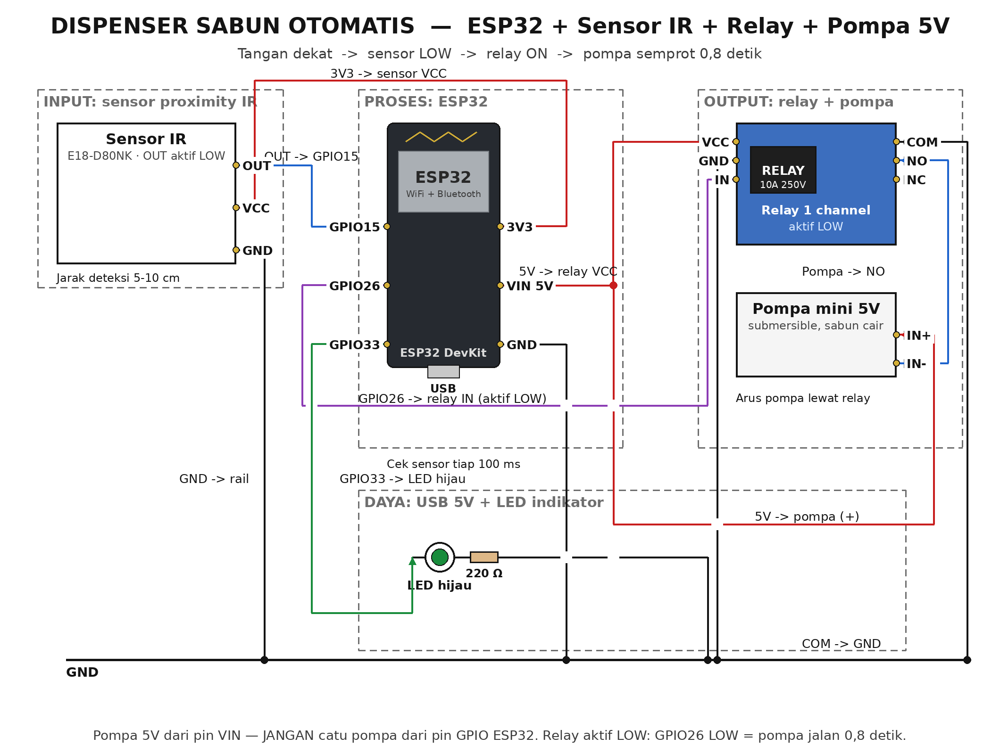

# Dispenser Sabun Otomatis — ESP32 + Sensor IR + Relay + Pompa Mini

Dekatkan tangan, sabun keluar sendiri — tanpa menyentuh botol, tanpa
menyentuh keran. Sensor proximity inframerah mendeteksi tangan di depan
sensor, ESP32 menghidupkan pompa mini lewat relay selama 0,8 detik, lalu
pompa mati dan masuk masa jeda supaya sabun tidak keluar terus-menerus.
LED hijau menyala selama pompa menyemprot.

Video penjelasan (60 detik): https://youtube.com/shorts/_9wFn7ajvd4

## Yang dipakai

- ESP32 DevKit (WiFi + Bluetooth)
- Sensor proximity IR, modul obstacle avoidance / E18-D80NK (output digital)
- Modul relay 1 channel, aktif LOW
- Pompa mini submersible 5V
- LED hijau + resistor 220 ohm
- Botol atau tandon sabun cair + selang kecil ke pompa
- Kabel jumper, breadboard atau PCB

## Wiring

| Dari | Ke | Keterangan |
| --- | --- | --- |
| Sensor IR OUT | GPIO15 | Output digital, aktif LOW (tangan terdeteksi) |
| Sensor IR VCC | 3V3 | Catu 3,3V supaya output tetap logika 3,3V |
| Sensor IR GND | GND | Ground bersama |
| Relay IN | GPIO26 | Aktif LOW |
| Relay VCC | 5V (VIN) | Catu relay dari pin VIN |
| Relay GND | GND | Ground bersama |
| Pompa mini (+) merah | 5V (VIN) | Langsung dari pin VIN |
| Pompa mini (−) hitam | Relay NO | Arus pompa lewat relay |
| Relay COM | GND | Menutup rangkaian pompa saat relay ON |
| LED hijau anoda | GPIO33 | Seri resistor 220 ohm |
| LED hijau katoda | GND | Ground bersama |
| ESP32 | USB 5V | Catu utama |

Perhatian: pompa 5V dicatu dari pin VIN, arusnya lewat relay — jangan
pernah mencatu pompa dari pin GPIO ESP32. Sensor dicatu 3V3, bukan 5V,
supaya tegangan output-nya tetap aman untuk GPIO ESP32.

## Cara kerja

Tangan masuk ke jangkauan sensor (sekitar 5–10 cm, bisa diatur lewat
trimpot di modul), output sensor turun ke LOW. ESP32 membaca sensor tiap
100 ms; begitu tangan terdeteksi dan masa jeda sudah lewat, GPIO26
ditarik LOW, relay aktif, dan pompa menyemprot selama 0,8 detik. Setelah
itu relay mati, LED padam, dan alat menunggu 1,2 detik sebelum bisa
menyemprot lagi. Semprotan berikutnya hanya terjadi kalau tangan masih
atau kembali terdeteksi.

## Konfigurasi

Semua pengaturan ada di bagian atas sketch
`DispenserSabunOtomatis/DispenserSabunOtomatis.ino`:

- `PIN_SENSOR_IR = 15` — pin output sensor IR
- `PIN_RELAY = 26` — pin IN relay (aktif LOW)
- `PIN_LED = 33` — pin LED hijau
- `WAKTU_SEMPROT_MS = 800` — lama pompa jalan tiap semprotan
- `WAKTU_JEDA_MS = 1200` — jeda antar semprotan
- `INTERVAL_CEK_MS = 100` — interval baca sensor

Perintah Serial Monitor (115200 baud):

- ketik `t` lalu Enter — uji semprot sekali tanpa tangan
- ketik `s` lalu Enter — tampilkan status dan jumlah semprotan

## Tips pemakaian

- Sabun yang terlalu kental membuat pompa mini bekerja berat — encerkan
  sedikit dengan air bila semprotan terasa lemah.
- Atur jarak deteksi lewat trimpot di modul sensor sampai LED modul
  menyala saat tangan berada sekitar 5–10 cm di depan sensor.
- Letakkan sensor menghadap ke bawah atau miring supaya tetesan sabun
  tidak menempel di lensa sensor.
- Jangan pasang sensor tepat di atas wastafel yang memantulkan cahaya —
  pantulan bisa membuat sensor membaca ada tangan padahal tidak ada.

## Verifikasi compile

Sketch terverifikasi compile 22 Nov 2026 dengan arduino-cli 1.6.0,
ESP32 core 4.0.0:

- Sketch memakai 292.729 byte (22%) dari program storage (maksimum
  1.310.720 byte)
- Variabel global memakai 23.224 byte (7%) dari dynamic memory
  (maksimum 327.680 byte)
- Tidak ada library eksternal — hanya fungsi bawaan Arduino/ESP32

## Skema

## Lisensi

MIT — lihat file `LICENSE`.
